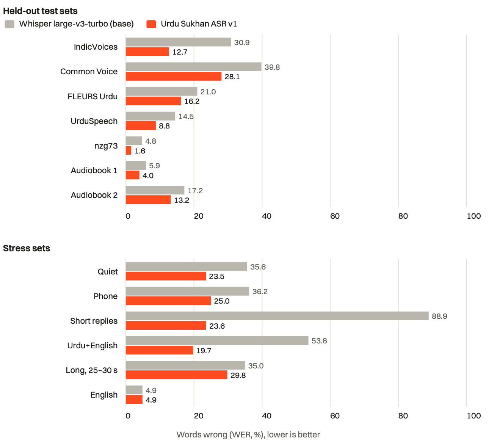
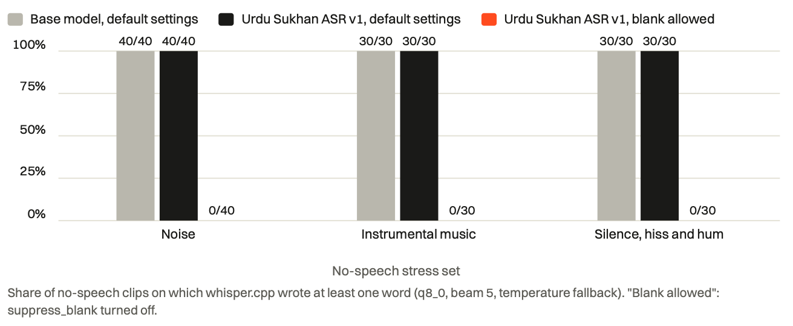
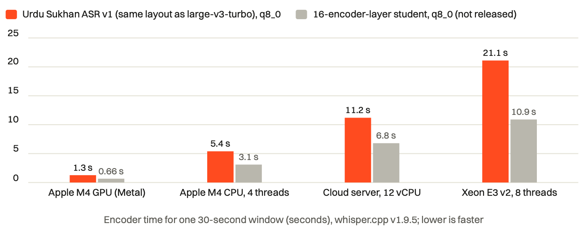

# Urdu Sukhan ASR

[](https://huggingface.co/Loudness-ai/urdu-sukhan-asr-v1)
[](https://github.com/Loudness-ai/urdu-sukhan-asr/releases/tag/v1.0.0)
[](https://huggingface.co/openai/whisper-large-v3-turbo)
[](requirements.txt)
[](https://colab.research.google.com/github/Loudness-ai/urdu-sukhan-asr/blob/main/notebooks/urdu_sukhan_asr_demo.ipynb)
[](LICENSE)
[](https://loudness.ai/research/urdu-speech-recognition-whisper/)

**Urdu Sukhan ASR** is an Urdu speech-to-text model by [Loudness.ai](https://loudness.ai) that also transcribes
English and speech that switches between Urdu and English. This repository holds everything behind it: ready-to-run
examples, the data preparation, training and evaluation code, the proofreading tool that produced part of its
training data, and the results of every evaluation.

Urdu Sukhan ASR v1 is a full fine-tune of OpenAI's Whisper large-v3-turbo (809 M parameters). It is published in
Transformers, whisper.cpp (q8_0, q5_0, q4_0) and CTranslate2 formats on
[Hugging Face](https://huggingface.co/Loudness-ai/urdu-sukhan-asr-v1), free for non-commercial use, with access
approved on request.

**Try it without installing anything**: [](https://colab.research.google.com/github/Loudness-ai/urdu-sukhan-asr/blob/main/notebooks/urdu_sukhan_asr_demo.ipynb) records your voice or takes a file and transcribes it on Colab's free GPU (after your access request is approved).

**Know before you use it**: names are its weakest point (11 of 23 spelled right in our test chapter); see [Limitations](#limitations) and what the [next version](#next-version) will fix.

**On loudness.ai**: [technical report](https://loudness.ai/research/urdu-speech-recognition-whisper/) (LA-RB-2026-004) · [model page](https://loudness.ai/developers/urdu-sukhan-asr/) · [install guide](https://loudness.ai/developers/guides/install-urdu-sukhan-asr/) · en español: [informe](https://loudness.ai/es/research/urdu-speech-recognition-whisper/), [modelo](https://loudness.ai/es/developers/urdu-sukhan-asr/), [guía](https://loudness.ai/es/developers/guides/install-urdu-sukhan-asr/).

## Results

Word error rate (WER, %; lower is better), greedy decoding, the same text normalisation for both models. None of these
clips were used in training. Our Common Voice, FLEURS and stress test sets are on Hugging Face as [Loudness-ai/urdu-sukhan-asr-test-sets](https://huggingface.co/datasets/Loudness-ai/urdu-sukhan-asr-test-sets), with access on request, so you can check these numbers or score another model on the same clips.

| Test set (clips) | Whisper large-v3-turbo | **Urdu Sukhan ASR v1** |
|---|---:|---:|
| IndicVoices Urdu, validation (300) | 30.9 | **12.7** |
| Common Voice Urdu, 15 speakers not seen in training (260) | 39.8 | **28.1** |
| FLEURS Urdu, test (299) | 21.0 | **16.2** |
| UrduSpeech, test split (100) | 14.5 | **8.8** |
| nzg73, held-out clips (300) | 4.8 | **1.6** |
| Audiobook narrators 1 and 2, held-out chapters (48, 10) | 5.9, 17.2 | **4.0, 13.2** |
| One- or two-word replies (40) | 88.9 | **23.6** |
| Quiet speech, phone-line speech (40 each) | 35.6, 36.2 | **23.5, 25.0** |
| Urdu then English in one clip (20) | 53.6 | **19.7** |
| English, FLEURS (30) | 4.9 | 4.9 |

<p align="center"></p>

<!-- EXAMPLES START -->
## Examples

Public test clips transcribed by Whisper large-v3-turbo and by Urdu Sukhan ASR v1, run the way an application runs them (whisper.cpp, q8_0, beam 5, temperature fallback, no timestamps). **Bold** marks a wrong word, [–] a missing one and [– N words] several, against the test set's reference after the same normalisation as our scores, so spelling and spacing count. ✅ marks the model with fewer mistakes on the clip and ❌ the one with more; a mistake is a wrong, extra or missing word. We picked these clips by hand to show where our model helps most, mostly from the top of a ranking of all clips by the number of words it fixed; the last example is one of the four clips where it did worse. Over all 47 clips with speech that we ran this way, our model was better on 27, worse on 4 and the same on 16 (19.1% against 37.8% words wrong).

**1. Urdu then English (Common Voice + FLEURS)** · ✅ Urdu Sukhan ASR better

https://github.com/user-attachments/assets/ea77c418-8699-4b19-b3a2-2ec33fc94589

| | Transcript | Result |
|---|---|---|
| Reference | اسی میں ہے Due to the underwater topology the return flow is concentrated at a few deeper sections and a fast current to deep water may form there | 28 words |
| Meaning | “It is right in this”, then an English sentence. The base model wrote four English words for the whole clip; ours wrote both halves and got the last two words wrong. | |
| Whisper large-v3-turbo | <b style="color:#d32f2f">You</b> <b style="color:#d32f2f">see</b> <b style="color:#d32f2f">me</b> <b style="color:#d32f2f">here.</b> <b style="color:#d32f2f">[– 24 words]</b> | ❌ 28 mistakes |
| **Urdu Sukhan ASR v1** | اسی میں ہے Due to the underwater topology the return flow is concentrated at a few deeper sections and a fast current to deep water may <b style="color:#d32f2f">run</b> <b style="color:#d32f2f">away</b> | ✅ 2 mistakes |

**2. Urdu then English (Common Voice + FLEURS)** · ✅ Urdu Sukhan ASR better

https://github.com/user-attachments/assets/ef475756-9c19-4a18-8ee1-e7018ebd511a

| | Transcript | Result |
|---|---|---|
| Reference | احتساب عدالت کا فیصلہ کیا ہوتا ہے In just two weeks the Americans and Free French forces had liberated southern France and were turning towards Germany | 26 words |
| Meaning | “What is the accountability court's verdict?”, then an English sentence. The base model translated the Urdu into English, wrongly, instead of writing it down; ours wrote both halves without a mistake. | |
| Whisper large-v3-turbo | <b style="color:#d32f2f">What</b> <b style="color:#d32f2f">is</b> <b style="color:#d32f2f">the</b> <b style="color:#d32f2f">decision</b> <b style="color:#d32f2f">of</b> <b style="color:#d32f2f">the</b> <b style="color:#d32f2f">government?</b> In just two weeks, the Americans and free French forces had liberated southern France and were turning towards Germany. | ❌ 7 mistakes |
| **Urdu Sukhan ASR v1** | احتساب عدالت کا فیصلہ کیا ہوتا ہے In just two weeks the Americans and free French forces had liberated Southern France and were turning towards Germany | ✅ no mistakes |

**3. One- or two-word reply (IndicVoices)** · ✅ Urdu Sukhan ASR better

https://github.com/user-attachments/assets/81ab5518-f7d3-4713-8d29-03d74eacb000

| | Transcript | Result |
|---|---|---|
| Reference | الگ الگ | 2 words |
| Meaning | “separately”. The base model wrote “Allah, Allah”. | |
| Whisper large-v3-turbo | <b style="color:#d32f2f">اللہ</b> <b style="color:#d32f2f">اللہ</b> | ❌ 2 mistakes |
| **Urdu Sukhan ASR v1** | الگ الگ | ✅ no mistakes |

**4. One- or two-word reply (IndicVoices)** · ✅ Urdu Sukhan ASR better

https://github.com/user-attachments/assets/c136e039-84a4-41a3-9d7b-7e941203db86

| | Transcript | Result |
|---|---|---|
| Reference | ہیلو | 1 words |
| Meaning | “hello”. The base model wrote “music”. | |
| Whisper large-v3-turbo | <b style="color:#d32f2f">موسیقی</b> | ❌ 1 mistake |
| **Urdu Sukhan ASR v1** | ہیلو | ✅ no mistakes |

**5. One- or two-word reply (IndicVoices)** · ✅ Urdu Sukhan ASR better

https://github.com/user-attachments/assets/9ef64edf-f723-48ad-b974-0c6ed3c11501

| | Transcript | Result |
|---|---|---|
| Reference | چھیاسی | 1 words |
| Meaning | “eighty-six” | |
| Whisper large-v3-turbo | <b style="color:#d32f2f">چاہاں</b> <b style="color:#d32f2f">سی</b> | ❌ 2 mistakes |
| **Urdu Sukhan ASR v1** | چھیاسی | ✅ no mistakes |

**6. IndicVoices, conversational** · ✅ Urdu Sukhan ASR better

https://github.com/user-attachments/assets/864bca94-a574-4970-bd4d-e8fd4df5cee8

| | Transcript | Result |
|---|---|---|
| Reference | جی جی جی ہاں | 4 words |
| Meaning | “yes, yes, yes, yes” | |
| Whisper large-v3-turbo | <b style="color:#d32f2f">دی</b> <b style="color:#d32f2f">دی</b> <b style="color:#d32f2f">دی</b> ہاں | ❌ 3 mistakes |
| **Urdu Sukhan ASR v1** | جی جی جی ہاں | ✅ no mistakes |

**7. Quiet speech (a Common Voice clip, 30 dB softer)** · ✅ Urdu Sukhan ASR better

https://github.com/user-attachments/assets/088b28c4-ce90-4543-86b7-ce91340befc5

| | Transcript | Result |
|---|---|---|
| Reference | ٹام کار کے حادثے میں بچ گیا تھا | 8 words |
| Meaning | “Tom survived the car accident.” Both models wrote the name Tom as ٹوم. | |
| Whisper large-v3-turbo | <b style="color:#d32f2f">ٹوم</b> کار <b style="color:#d32f2f">کی</b> <b style="color:#d32f2f">ہاتھ</b> <b style="color:#d32f2f">سے</b> میں بچ <b style="color:#d32f2f">کیا</b> تھا | ❌ 5 mistakes |
| **Urdu Sukhan ASR v1** | <b style="color:#d32f2f">ٹوم</b> کار کے حادثے میں بچ گیا تھا | ✅ 1 mistake |

**8. Phone line (a Common Voice clip)** · ✅ Urdu Sukhan ASR better

https://github.com/user-attachments/assets/9111ea1f-35c5-4be5-93be-c4656eaeb4be

| | Transcript | Result |
|---|---|---|
| Reference | اس ماحول میں جو آزادی نظر آتی ہے | 8 words |
| Meaning | “the freedom that one sees in this atmosphere” | |
| Whisper large-v3-turbo | اس <b style="color:#d32f2f">محول</b> میں جو <b style="color:#d32f2f">ازادی</b> نظر آتی ہے | ❌ 2 mistakes |
| **Urdu Sukhan ASR v1** | اس ماحول میں جو آزادی نظر آتی ہے | ✅ no mistakes |

**9. UrduSpeech · one of the four clips where ours did worse** · ❌ Urdu Sukhan ASR worse

https://github.com/user-attachments/assets/515ecb6d-4796-4f28-9ad5-feeba4c39826

| | Transcript | Result |
|---|---|---|
| Reference | گیا آنند وہار غریب رتھ ایکسپریس | 6 words |
| Meaning | “Gaya – Anand Vihar Garib Rath Express” (a train). Ours wrote “Anand Vihar” as one word. | |
| Whisper large-v3-turbo | گیا آنند <b style="color:#d32f2f">ویہار</b> غریب رتھ ایکسپریس | ✅ 1 mistake |
| **Urdu Sukhan ASR v1** | گیا <b style="color:#d32f2f">آنندوہار</b> <b style="color:#d32f2f">[–]</b> غریب رتھ ایکسپریس | ❌ 2 mistakes |

**No speech**: on audio without speech, every Whisper decoder by default must write at least one word. Allowing an empty result (`suppress_blank = false`, or `-nsb` with our patch) only helps a model that has learned to stop. Any word here is a mistake.

*Faint hiss and hum*

https://github.com/user-attachments/assets/b8745c28-ad13-4f01-82b7-af46638222f5

| | default | blank allowed |
|---|---|---|
| Whisper large-v3-turbo | ❌ <b style="color:#d32f2f">موسیقی</b> (“music”) | ❌ <b style="color:#d32f2f">موسیقی</b> |
| **Urdu Sukhan ASR v1** | ❌ <b style="color:#d32f2f">اچھا</b> (“all right”) | ✅ *(nothing)* |

*Noise (MUSAN)*

https://github.com/user-attachments/assets/4e4684e6-370f-4184-bfd9-9d8733993342

| | default | blank allowed |
|---|---|---|
| Whisper large-v3-turbo | ❌ <b style="color:#d32f2f">موسیقی</b> (“music”) | ❌ <b style="color:#d32f2f">موسیقی</b> |
| **Urdu Sukhan ASR v1** | ❌ <b style="color:#d32f2f">اچھا</b> (“all right”) | ✅ *(nothing)* |

Clips: Common Voice (CC0), FLEURS (CC BY 4.0, Google), IndicVoices and UrduSpeech/Rasa (CC BY 4.0, AI4Bharat), MUSAN (CC BY 4.0); the quiet, phone and Urdu-then-English clips are Common Voice and FLEURS clips that we turned down, passed through a phone filter or joined, and the hiss is generated.
<!-- EXAMPLES END -->

## Quick start

A step-by-step guide for Windows, macOS and Linux is on [loudness.ai](https://loudness.ai/developers/guides/install-urdu-sukhan-asr/).

### Get access to the model

The code here is open to read; the model files are on [Hugging Face](https://huggingface.co/Loudness-ai/urdu-sukhan-asr-v1),
free for non-commercial use under [CC BY-NC 4.0](LICENSE) and approved by hand. Request access with the form on the
model page, wait for approval, then log in once on each machine:

```bash
pip install -U huggingface_hub
hf auth login
```

For commercial use, [contact us](https://loudness.ai/contact-us/).

Pick the runtime for your hardware:

| Hardware | Use | Example |
|---|---|---|
| CPU (servers, laptops), Apple Silicon, phones | whisper.cpp | `bash examples/whisper_cpp.sh speech.wav` |
| CPU, long recordings | faster-whisper | `python examples/transcribe_faster_whisper.py lecture.wav` |
| NVIDIA GPU | Transformers or faster-whisper | `python examples/transcribe_transformers.py speech.wav` |

Transformers on a CPU works but is slow (about 10 times slower than real time on a 12-core cloud server); use
whisper.cpp or faster-whisper there.

```bash
pip install -r examples/requirements.txt   # Python 3.12
```

**whisper.cpp.** The script builds whisper.cpp v1.9.5 with a one-line
[patch](examples/whisper-cpp-no-suppress-blank.patch) that lets silence give no text, downloads the model and the
Silero voice detector, and transcribes with the recommended settings:

```bash
bash examples/whisper_cpp.sh speech.wav                         # q8_0
QUANT=q4_0 THREADS=8 bash examples/whisper_cpp.sh speech.mp3    # fastest on x86 servers
```

Or with your own whisper.cpp build:

```bash
hf download Loudness-ai/urdu-sukhan-asr-v1 ggml/ggml-urdu-sukhan-asr-v1-q8_0.bin --local-dir .
whisper-cli -m ggml/ggml-urdu-sukhan-asr-v1-q8_0.bin -l ur -bs 5 -nt -mc 0 -f speech.wav
```

**faster-whisper**, with voice detection and batched decoding; prints each piece as it is transcribed:

```bash
python examples/transcribe_faster_whisper.py lecture.wav --timestamps
```

**Transformers**, on an NVIDIA GPU, an Apple GPU or the CPU; any length of audio:

```bash
python examples/transcribe_transformers.py interview.flac --beams 5
```

```python
from transformers import pipeline
asr = pipeline("automatic-speech-recognition", model="Loudness-ai/urdu-sukhan-asr-v1", device="cuda:0")
print(asr("speech.wav", chunk_length_s=30, generate_kwargs={"language": "ur"})["text"])   # file input needs ffmpeg
```

## Recommended settings

| Setting | Why |
|---|---|
| Set the language (`ur` or `en`) when you know it | language detection costs whisper.cpp an extra encoder pass per window, doubling the time on short clips |
| Allow an empty result: `suppress_blank = false` (whisper.cpp), `-nsb` with our patch | otherwise every Whisper model must write a word on silence; with it off, our model writes nothing on noise, music and silence, and speech scores do not change |
| Voice detector (Silero VAD) | skips non-speech; very faint speech can be dropped |
| No timestamps, no carried context (`-nt -mc 0`) | avoids clips cut short at long pauses and errors carried between windows |
| Beam search 5 with temperature fallback | slightly better than greedy |
| A prompt listing expected names (`--prompt`) | names are the weakest point; a prompt raised names spelled right from 12 to 17 of 23 |
| x86 servers: q4_0, about 8 threads per job | q4_0 is the fastest format there; on a shared server, using every core made a clip 3× slower |

<p align="center"></p>

## Speed

### Compared with Whisper large-v3

| | Whisper large-v3 | Urdu Sukhan ASR v1 (layout of large-v3-turbo) |
|---|---:|---:|
| Parameters | 1,550 M | 809 M |
| Encoder / decoder layers | 32 / 32 | 32 / 4 |
| whisper.cpp file, fp16 | 3,095 MB | 1,625 MB |
| whisper.cpp file, q5_0 | 1,081 MB | 574 MB |
| GPU memory (OpenAI's figure) | about 10 GB | about 6 GB |
| Relative speed (OpenAI's figure: English speech on an A100 GPU) | 1× | about 8× |

File sizes are those in [whisper.cpp's model repository](https://huggingface.co/ggerganov/whisper.cpp); memory and
speed are from [OpenAI's Whisper README](https://github.com/openai/whisper#available-models-and-languages). The two
models share the same 32-layer encoder; the speed-up comes from the decoder, which runs once for every output token.
On a CPU in whisper.cpp the encoder does about 95% of the work (below), so the gain there is smaller. We have not
timed or scored Whisper large-v3 ourselves.

### Measured speed

The model has the layout of Whisper large-v3-turbo, so its speed is that model's. In whisper.cpp the encoder does
about 95% of the work on a CPU and always processes a full 30-second window.

<p align="center"></p>

| Machine | Measurement |
|---|---|
| Apple M4, GPU (Metal) | encoder 1.3 s per 30 s window; book clips at 4–6× real time |
| Apple M4, CPU, 4 threads | encoder 5.4 s per window |
| Cloud server, 12 AMD EPYC vCPUs | encoder 11.2 s per window; a 6 s clip in 13.0 s (q4_0) to 20.0 s (q8_0) with the language set |
| Same server, faster-whisper int8 | a 27-minute recording in 15.6 min (greedy, 1.76× real time) or 18.1 min (beam 5) |

## Repository layout

| Path | What |
|---|---|
| `examples/` | inference scripts for Transformers, faster-whisper and whisper.cpp, the whisper.cpp patch, pinned requirements |
| `notebooks/urdu_sukhan_asr_demo.ipynb` | the Colab demo: record, upload or try public clips |
| `wlite/` | shared code: Urdu text normalisation and house style, audio helpers, whisper.cpp runner, proofreading projects |
| `scripts/transcribe.py`, `proofread.py`, `proofread/`, `review_batch.py`, `learn_corrections.py`, `export_dataset.py` | the proofreading loop: draft long recordings, correct them in the browser, export training clips ([docs](docs/proofreading-loop.md)) |
| `scripts/import_common_voice.py`, `get_fleurs.py`, `get_hf_audio.py`, `get_musan.sh`, `pseudo_label.py` | download and prepare public data; transcribe unlabelled audio with a trained model |
| `scripts/make_r6_train.py`, `make_r6_extras.py` | build the cleaned training manifests, no-speech clips, code-switch clips, test and stress sets |
| `scripts/train.py`, `r6_train.sh`, `average_models.py` | fine-tuning (LoRA or full), augmentation, checkpointing; weight averaging |
| `scripts/eval_hf.py`, `cpp_stress.py`, `cpp_stress_x.py`, `name_check.py`, `recount_loops.py` | evaluation in Transformers (GPU) and in whisper.cpp as an application runs it |
| `scripts/export_ggml.py`, `export_coreml.py`, `check_coreml.py`, `ggml_to_hf.py`, `verify_hf_rebuild.py` | exports to whisper.cpp and Core ML; rebuilding Transformers weights from a whisper.cpp file |
| `scripts/student_*.py`, `train_student.py` | an encoder-pruning and distillation experiment (not released) |
| `tools/testpage/` | a small web page to try models on a CPU server: live recording, uploads, held-out clips |
| `tools/speedkit/`, `tools/testpage/long_bench.py` | speed and accuracy benchmarks |
| `results/` | result tables of the evaluations |
| [`DATA_SOURCES.md`](DATA_SOURCES.md) | training data, licences and credits |
| [`LICENSE`](LICENSE) | CC BY-NC 4.0, for the code and the model |
| [`NOTICE.md`](NOTICE.md) | OpenAI's MIT notice for Whisper |
| [`CITATION.cff`](CITATION.cff) | how to cite the technical report |
| [`docs/development-log.md`](docs/development-log.md) | every problem met during the work, its cause and fix, and the timeline |

Datasets, recordings and model files are not in this repository.

## Reproducing the model

The released model is round 6 of training. On one 16 GB GPU (we used an RTX A4000):

```bash
uv venv -p 3.12 .venv && uv pip install --python .venv/bin/python -r requirements.txt
python scripts/get_fleurs.py ur_pk --splits train dev test   # FLEURS Urdu
bash scripts/r6_downloads.sh                 # IndicVoices, UrduSpeech, FLEURS English
bash scripts/get_musan.sh                    # MUSAN noise and music
# Common Voice Urdu: scripts/import_common_voice.py; nzg73: scripts/get_hf_audio.py (each has --help)
python scripts/make_r6_extras.py train       # no-speech and code-switch clips
python scripts/make_r6_extras.py tests       # IndicVoices and UrduSpeech test sets
python scripts/make_r6_extras.py stress      # stress sets
python scripts/make_r6_train.py              # cleaned manifests in data/r6/
bash scripts/r6_train.sh                     # full fine-tune, checkpoint every 925 steps, about 4.5 hours
python scripts/eval_hf.py --base models/hf/whisper-large-v3-turbo --models r6=models/runs/novel-r6/ckpt-2775 \
    --manifests data/stress/*.jsonl --name r6_stress      # choose the checkpoint with the stress sets
python scripts/export_ggml.py --base models/hf/whisper-large-v3-turbo --model models/runs/novel-r6/ckpt-2775 \
    --name urdu-sukhan-asr-v1 --quant q8_0 q5_0 q4_0
```

The audiobook recordings and the transcribed UAT audio are not public, so an exact reproduction is not
possible from public data alone; training without them gives a close but different model. What we would change in a next round is under
[Next version](#next-version).

## Limitations

Read these before relying on the model.

- **Names are its weakest point.** The test chapter of our second audiobook has 23 name occurrences: Urdu Sukhan ASR
  spelled 11 right, the base model 4. Names it rarely heard in training come out as similar common words, for example
  عمیر (Umair) as امیر (“rich”) and تانیا (Tania) as دانیا. A prompt listing the expected names raised the count from 12
  to 17 of 23 in whisper.cpp. FLEURS news, full of foreign names, is where it improves least. When names matter (people,
  places, brands), give them in a prompt and check them by hand.
- **Word spacing and spelling**: words are sometimes joined or split (آنندوہار for آنند وہار), and spelling follows our
  house style, which can differ from yours.
- **No punctuation**: transcripts come without punctuation, like the training text.
- **Very faint English after Urdu** can come out in Urdu letters or repeat a word.
- **Narrator-specific pronunciations** (for example a dropped ھ: پھر heard as پر) are sometimes written as pronounced.
- **Silence**: without the blank setting under Recommended settings, it writes a word such as اچھا on silence, as every Whisper model does.
- **Accents and settings**: IndicVoices is mostly Indian Urdu, the Common Voice test has few women, and we have no test
  of spontaneous phone conversations between Pakistani speakers. Our test sets are small (20 to 300 clips) and we
  report no confidence intervals.
- **Speed on CPUs**: every clip pays for a full 30-second window; short live clips are slower than real time on
  small CPUs.
- **Not measured**: we have not scored or timed Whisper large-v3, measured memory use, or run the model on a phone.

## Next version

What we plan to change for the next model, each from a problem this one showed:

| Problem in v1 | Plan for the next model |
|---|---|
| Names: 11 of 23 right in our test chapter; rare names become common words | More name-rich training speech (news, interviews, stories with many characters), a larger test set of names, and name prompts in the examples and test page |
| Faint training speech taught the model to hear words in hiss | Set every clip to a normal level before augmenting it |
| One word on silence unless an empty result is allowed | Encode empty transcripts without a space, so the model can stop with default settings |
| Stress-test noise and music were heard in training | Keep test noise and music out of augmentation |
| Joined or split words | Check training transcripts for word spacing and count spacing errors separately |
| Every clip pays for a 30-second window on CPUs | Fine-tune for shorter audio windows; train a smaller, faster student on more teacher-transcribed audio (our 16-layer student was 1.9× faster in the encoder but 0.5–5.4 points less accurate, so it is not released) |
| No iPhone build (the Core ML encoder lost precision) | A precise on-device build for iPhone |
| Settings we have not tested | Pakistani conversational and phone speech, more women speakers, larger test sets with confidence intervals, memory and phone measurements, and a direct comparison with Whisper large-v3 |

## Citation

If you use this model or code, please cite the technical report:

```bibtex
@techreport{shehzad2026urdusukhan,
  author      = {Asad Shehzad},
  title       = {Urdu Sukhan {ASR}: Accurate {Urdu} Speech Recognition at Half the Size of {Whisper} large-v3},
  institution = {Loudness.ai},
  number      = {LA-RB-2026-004},
  year        = {2026},
  url         = {https://loudness.ai/research/urdu-speech-recognition-whisper/}
}
```

## Licence and credits

Licence: [CC BY-NC 4.0](LICENSE) for the code and the model, non-commercial use only. The model files are on
Hugging Face, where access is approved on request. For commercial use, [contact us](https://loudness.ai/contact-us/). OpenAI's MIT notice
for Whisper is in [`NOTICE.md`](NOTICE.md).

Developed by Asad Shehzad, Loudness.ai. Audiobook transcripts proofread by Asad Shehzad. Built on
OpenAI Whisper large-v3-turbo. Data from AI4Bharat (IndicVoices, Rasa), Mozilla Common Voice, Google FLEURS,
Muhammad Noman – nzg73, the UAT authors and MUSAN; see [`DATA_SOURCES.md`](DATA_SOURCES.md). Inference with
[whisper.cpp](https://github.com/ggml-org/whisper.cpp), [faster-whisper](https://github.com/SYSTRAN/faster-whisper) and
[Silero VAD](https://github.com/snakers4/silero-vad).
